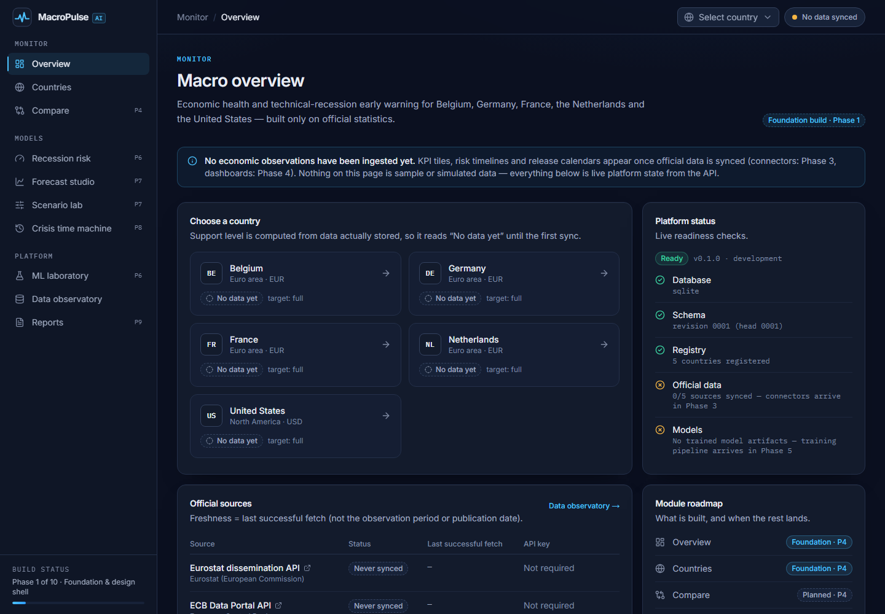
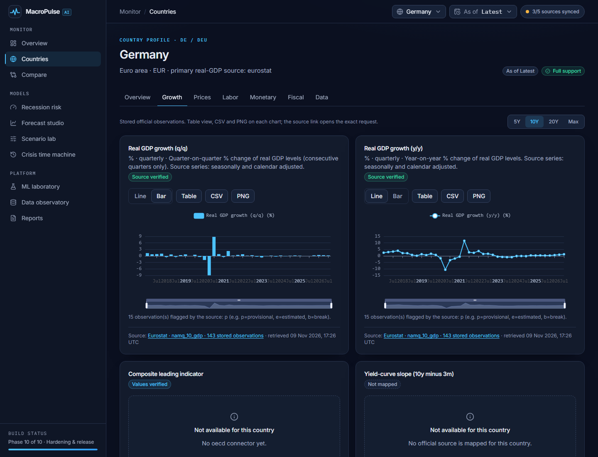
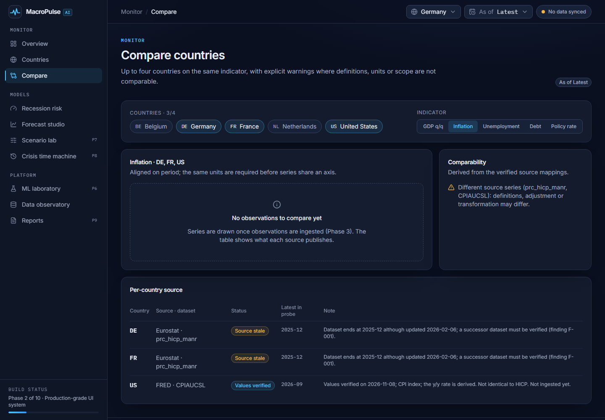
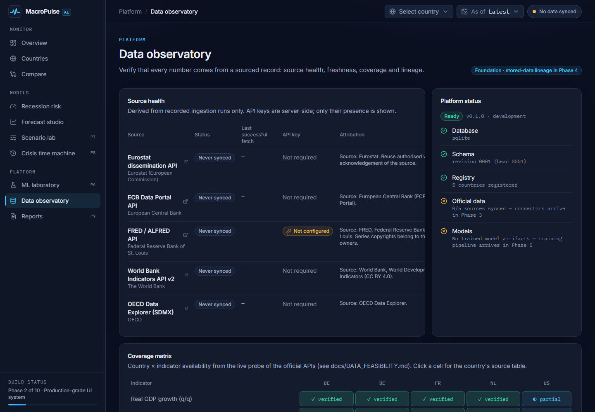
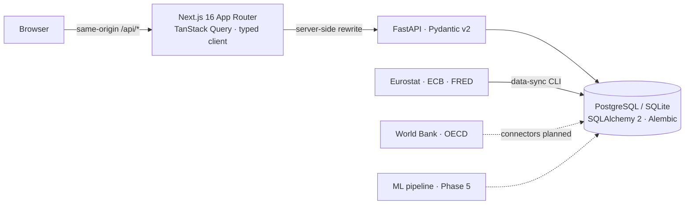

# MacroPulse AI

**Macroeconomic intelligence and technical-recession early warning, built only on official statistics.**

MacroPulse AI monitors Belgium, Germany, France, the Netherlands and the United States using data from
Eurostat, the ECB, FRED, the World Bank and the OECD, and (from Phase 5) estimates the probability of a
*technical recession* — at least two consecutive quarters of negative real-GDP q/q growth — within the
next 2 or 4 quarters, with transparent, walk-forward-evaluated and calibrated models.

> **Engineering truth over flashy claims.** The UI never shows a number that is not traced to a sourced
> observation or a measured model output. Unbuilt modules say so. Missing data stays missing.



| Country explorer | Compare | Data observatory |
| --- | --- | --- |
|  |  |  |

## Status

The project is built in ten verified phases ([roadmap](docs/ROADMAP.md)). **Phases 1–3 are complete:**
foundation, production-grade UI system, and official-data ingestion. Phase 4 (dashboards plotting the stored
series) is next.

| Area | Working now (verified) | Next |
| --- | --- | --- |
| Monorepo | pnpm + uv workspaces, pinned deps, lockfiles, `.env.example`, CI, Dockerfiles, compose | — |
| Official data | `macropulse data-sync`: Eurostat (JSON-stat), ECB (SDMX CSV) and FRED connectors with timeouts, retries/backoff, `Retry-After`, throttling, response validation, idempotent upserts, per-series quality checks and partial-failure runs. **Live run 2026-11-09: 21,094 observations from 24 series**, all runs succeeded | OECD and World Bank connectors; FRED API-key metadata/ALFRED vintages |
| API (FastAPI) | `/api/health`, `/api/ready`, `/api/countries` (support levels computed from stored data: BE/DE/FR/NL `full`, US `partial`), `/api/sources/status`, `/api/indicators/catalog`, **`/api/indicators?country=&indicator=&start=&end=`** (derived series + provenance + quality checks); structured error contract, request ids, JSON logs, restricted CORS; Alembic migrations (SQLite ↔ PostgreSQL) | Country summary & data-quality endpoints (Phase 4) |
| Web (Next.js 16) | Design system with URL-shareable context (country + as-of quarter), KPI tiles and chart frames that report stored counts and latest periods, ECharts (CSV/PNG export, accessible table view), country explorer tabs, compare with comparability warnings, coverage matrix; loading / error-with-retry / offline / stale / not-built states; no overflow at 375 px | Plot the stored series with provenance tooltips (Phase 4) |
| Data feasibility | 45 live probes of official endpoints → [`docs/DATA_FEASIBILITY.md`](docs/DATA_FEASIBILITY.md); HICP successor `prc_hicp_minr` verified | — |
| Models | — (no model trained; the UI says so) | Baselines → logistic regression → gradient boosting (Phase 5) |

Verified on 2026-11-09 (Windows 11): 121 pytest tests (+1 PostgreSQL test that runs in CI, +12 opt-in live
API tests run with `MACROPULSE_LIVE_TESTS=1`), ruff, mypy `--strict`; ESLint, `tsc`, 53 Vitest tests and
`next build`; a live `data-sync` against Eurostat, ECB and FRED, re-run to confirm idempotency; browser checks of
the Overview and Data Observatory against the synced database.
**Not verified locally:** `docker compose up` (Docker is not installed on the development machine — CI builds
the images).

## Quickstart

Prerequisites: **Node.js ≥ 22.12** with **pnpm** (`npm i -g pnpm`), **Python 3.12** with
**[uv](https://docs.astral.sh/uv/)**. Docker is optional.

```powershell
# Windows PowerShell (same commands on macOS/Linux)
pnpm bootstrap    # pnpm install + uv sync + migrate the local SQLite database
pnpm data:sync    # fetch the official series (Eurostat, ECB, FRED) — needs internet, ~15 s
pnpm dev          # API on http://127.0.0.1:8000, web on http://localhost:3000
```

- App: <http://localhost:3000> · API docs (OpenAPI): <http://127.0.0.1:8000/api/docs>
- Local development uses SQLite (`data/local/macropulse.db`); production uses PostgreSQL.
- Optional: copy `.env.example` to `.env` and set `FRED_API_KEY` (server-side only) for FRED/ALFRED features.

With Docker (PostgreSQL + API + web):

```bash
docker compose up --build
```

### Commands

| Command | What it does |
| --- | --- |
| `pnpm dev` / `pnpm dev:api` / `pnpm dev:web` | Run both services / API only / web only |
| `pnpm db:upgrade` | Apply migrations and sync the country/source registry (idempotent) |
| `pnpm data:sync` | Fetch all mapped official series. Narrow it with `uv run macropulse data-sync --source eurostat --country DE`. Exit code 1 if any run is partial or failed |
| `$env:MACROPULSE_LIVE_TESTS = "1"; uv run pytest -m live` | Opt-in checks against the real APIs (not run in CI) |
| `pnpm test` | pytest + Vitest |
| `pnpm lint` | ruff, ruff format, mypy, ESLint, tsc |
| `pnpm build` | Next.js production build |
| `pnpm gen:types` | Regenerate TypeScript API types from the FastAPI OpenAPI schema |
| `uv run python scripts/probe_sources.py --out docs/data-feasibility-probe.json` | Re-run the live source feasibility probe |

## Architecture



- **One typed contract:** Pydantic models → OpenAPI → `packages/shared-types` (openapi-typescript) →
  `openapi-fetch` in the browser. CI fails if the committed schema or types drift.
- **Honest state everywhere:** country support levels are *computed* from stored observations; source
  freshness is the *last successful fetch*, derived from recorded ingestion runs. Derived indicators (q/q, y/y)
  are computed at read time from the native series and only across adjacent published periods — gaps stay gaps.
- Details: [`docs/ARCHITECTURE.md`](docs/ARCHITECTURE.md).

## Methodology (summary)

- **Target:** a technical recession occurs within horizon H ∈ {2, 4} if at least one pair of consecutive
  quarters with negative q/q real-GDP growth lies entirely inside the next H quarters. Zero growth is not
  negative; labels whose horizon is not yet observable are censored.
- **NBER is not the target.** US NBER recession dates (FRED `USREC`) are shown only as an external reference.
- **No leakage:** walk-forward evaluation with horizon gaps; scalers/imputers fit on training folds only;
  as-of feature snapshots with conservative release lags. Without true vintages (Eurostat), historical
  replays are labelled *revised-data / release-lag approximation*.
- **Metrics that matter for rare events:** Brier score, log loss, calibration, PR-AUC and baselines — not
  accuracy on mostly non-recession quarters.

## Data sources and attribution

| Source | Used for | Terms |
| --- | --- | --- |
| [Eurostat](https://ec.europa.eu/eurostat/web/user-guides/data-browser/api-data-access/api-introduction) | Quarterly real GDP (`namq_10_gdp`), unemployment, HICP, government debt | Reuse with acknowledgement |
| [ECB Data Portal](https://data.ecb.europa.eu/help/api/overview) | Shared euro area policy rates | Reuse with source attribution |
| [FRED / ALFRED](https://fred.stlouisfed.org/docs/api/fred/series_observations.html) | US indicators, vintages, NBER reference | Series-specific; see FRED legal |
| [World Bank](https://datahelpdesk.worldbank.org/knowledgebase/articles/889392) | Annual structural indicators | CC BY 4.0 |
| [OECD](https://data-explorer.oecd.org/) | Composite leading indicators | OECD terms |

NBER business-cycle dating reference:
<https://www.nber.org/research/business-cycle-dating/business-cycle-dating-procedure-frequently-asked-questions>.
Key feasibility findings (e.g. Eurostat's `prc_hicp_manr` ends at 2025-12; OECD CLI is not published for
BE/NL) are in [`docs/DATA_FEASIBILITY.md`](docs/DATA_FEASIBILITY.md).

## Repository layout

```
apps/web               Next.js App Router frontend (TypeScript strict, Tailwind v4, TanStack Query)
apps/api               FastAPI service, Alembic migrations, CLI (`macropulse`)
packages/economics     Country/indicator registry, official-data connectors, transforms, quality rules
packages/shared-types  Generated TypeScript types from the OpenAPI schema
scripts/               Source probe; scripts/agents for AI-agent delegation
docs/                  Architecture, roadmap, data feasibility (+ raw probe evidence)
```

## Knowledge base (Obsidian)

`vault/` is an [Obsidian](https://obsidian.md) vault holding the project's memory: live status, phase notes,
architecture decisions (ADRs), verified data sources and findings, methodology, Codex run reports, daily
session journals, Bases dashboards and an architecture canvas. Claude Code hooks (`.claude/settings.json`)
and the Codex runner log activity automatically into `vault/80 Logs/` (local only, secrets redacted). Open the
`vault` folder in Obsidian and start at **Home**.

## AI-assisted development

Built with Claude Code as lead engineer and OpenAI Codex for scoped side tasks (briefs in `.agents/briefs/`,
rules in [`AGENTS.md`](AGENTS.md), runner `scripts/agents/codex-task.ps1`). Every delegated result is reviewed
and re-verified before it is accepted; nothing is reported as working without being run.

## Disclaimer

MacroPulse AI produces analytical estimates for research and education. It is not investment advice, and
model probabilities are not certainties.

## License

Code: [MIT](LICENSE). Data remains subject to each publisher's terms (see above).
