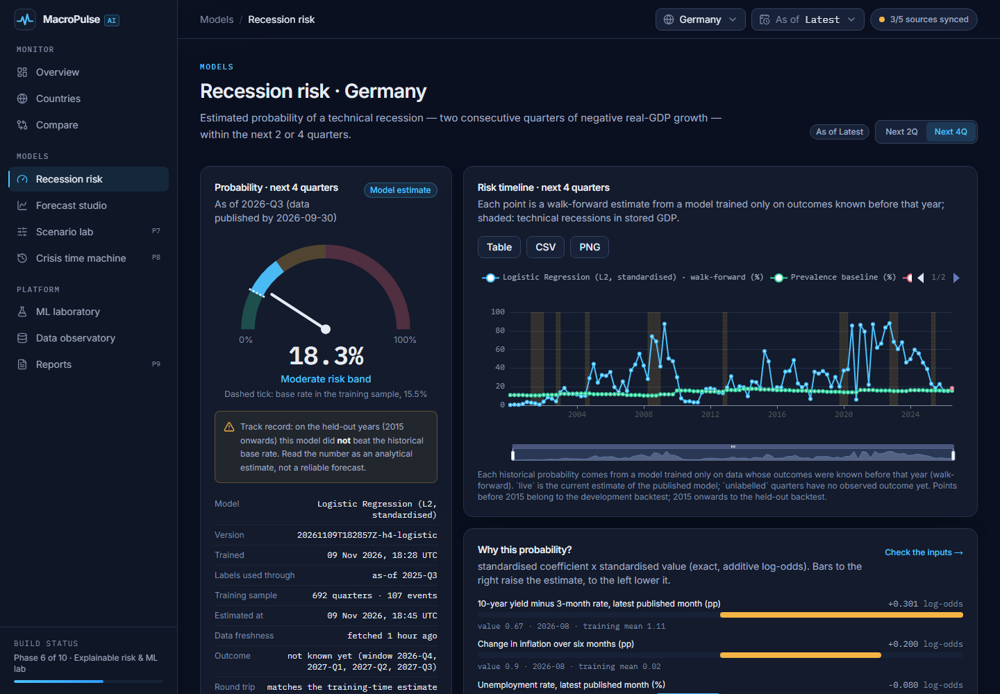
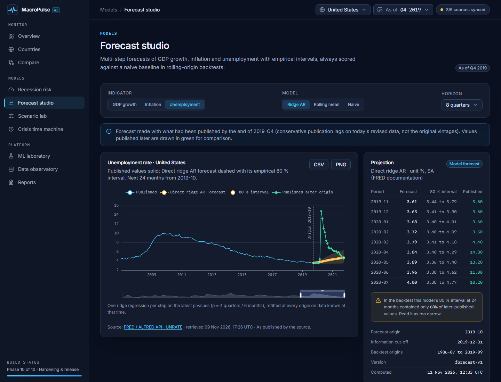
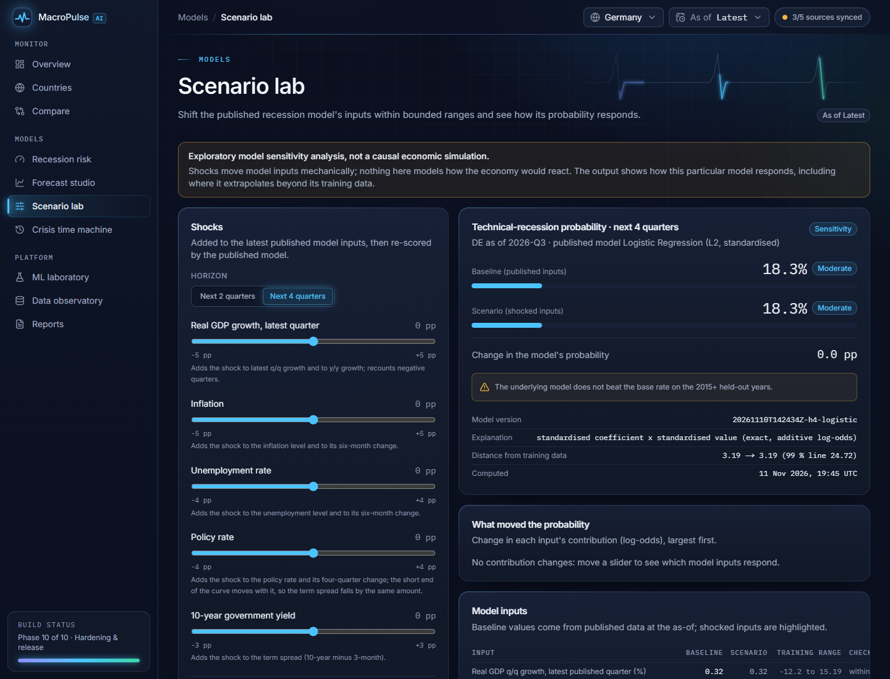
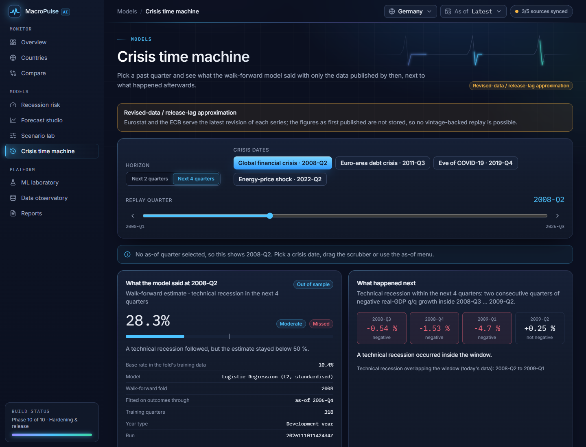
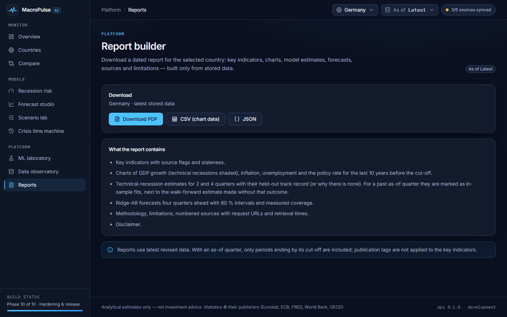
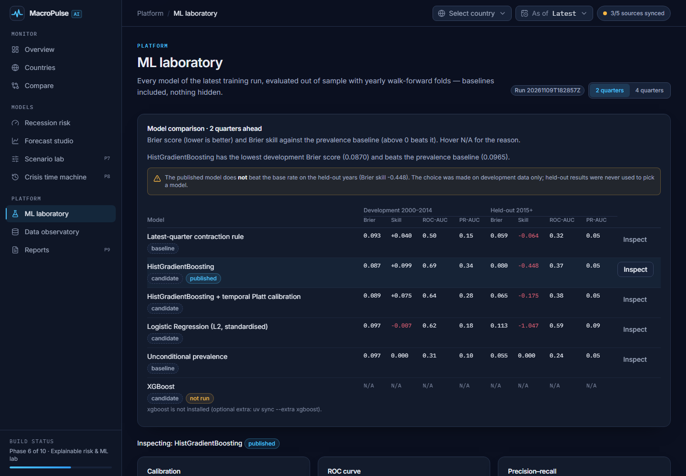
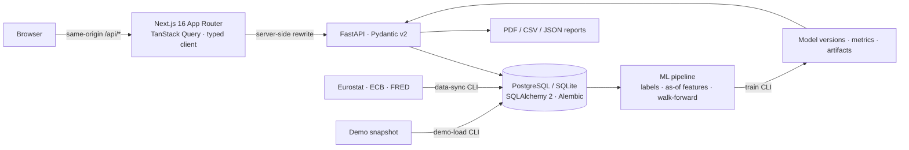

# MacroPulse AI

**Macroeconomic intelligence and technical-recession early warning, built only on official statistics.**

MacroPulse AI monitors Belgium, Germany, France, the Netherlands and the United States with data from
Eurostat, the ECB and FRED, and estimates the probability of a *technical recession* — at least two
consecutive quarters of negative real-GDP q/q growth — within the next 2 or 4 quarters, with
walk-forward-evaluated models whose track record is shown next to every number.

> **Engineering truth over flashy claims.** The UI never shows a number that is not traced to a sourced
> observation or a measured model output. Missing data stays missing. Model weaknesses are stated, not hidden.


| Recession risk | Forecast studio | Scenario lab |
| --- | --- | --- |
|  |  |  |
| **Crisis time machine** | **Report builder** | **ML laboratory** |
|  |  |  |
| **Country explorer** | **Compare** | **Data observatory** |
|  |  |  |

All screenshots are real: the production build (`next build && next start`) on data synced from the
official APIs on 2026-11-09, captured on 2026-11-11 (after the visual refresh).

## Status

All ten phases of the [roadmap](docs/ROADMAP.md) are complete. The release audit is in
[`docs/SECURITY.md`](docs/SECURITY.md), deployment in [`docs/DEPLOY.md`](docs/DEPLOY.md), the design system in
[`docs/DESIGN.md`](docs/DESIGN.md).

> [!IMPORTANT]
> **Model result, stated plainly.** The published models beat the historical base rate on the 2000–2014
> development backtest (Brier skill +0.10 for 2 quarters ahead, +0.03 for 4) but **not on the held-out
> years 2015–2026** (−0.45 and −0.75). In walk-forward replays the 2-quarter model warned before **0 of 20**
> evaluable technical recessions and the 4-quarter model before **6 of 22**; COVID-2020 is not foreseeable
> from these inputs. Probabilities are therefore shown as analytical estimates with this track record —
> never as forecasts of certainty.

### What works, what partly works, what is not implemented

| Area | State | Details |
| --- | --- | --- |
| Official data (Eurostat, ECB, FRED) | ✅ Works | `macropulse data-sync`: 31 native series, 25,702 observations (live run 2026-11-09), timeouts, retries, throttling, validation, quality checks, partial-failure runs, credential redaction in stored URLs |
| Offline demo | ✅ Works | `pnpm demo`: genuine snapshot of that sync (`data/demo/`, attributed), loaded through the normal pipeline, **DEMO banner** while in use |
| Country support | ✅ BE, DE, FR, NL `full` · ⚠️ US `partial` | Computed from stored data. US: series metadata (units/adjustment) needs the FRED API, which needs a key |
| Dashboards (overview, countries, compare, data observatory) | ✅ Works | Provenance on every value, as-of cut-off, CSV/PNG export, lineage, raw-row CSV |
| Technical-recession models | ⚠️ Works, weak | Labels with censoring, as-of features with publication lags, walk-forward backtest, calibration, published model + explanations — but no held-out skill (see above). Candidates: logistic regression, HistGradientBoosting (± temporal Platt), a small L2-regularised neural network (MLP, 8 units; published for 4 quarters since 2026-11-12 by the development-only rule, held-out skill still negative) |
| Forecast studio | ⚠️ Works, intervals too narrow | Naive / rolling mean / ridge AR, rolling-origin backtests; measured 80 % interval coverage is 71–74 % (median), shown and flagged |
| Scenario lab | ✅ Works | Bounded, non-causal sensitivity of the published model with plausibility checks; it shows counter-intuitive model behaviour (higher unemployment lowers the 4-quarter estimate) instead of hiding it |
| Crisis time machine | ⚠️ Approximation (US: plus first-release check) | Walk-forward replays with a leakage test, labelled *revised-data / release-lag approximation*. For the US the same fold model is re-fitted, must reproduce its stored estimate, and is scored again on GDP, CPI and unemployment as first published (ALFRED) — the model itself was still trained on revised data |
| Report builder | ✅ Works | Dated PDF / chart-data CSV / JSON with sources, methodology and limitations |
| Release engineering | ✅ Works | CI: lint, types, 287 pytest, 134 Vitest, build, 58 Playwright E2E (desktop + mobile, axe, failure paths), Docker compose stack on PostgreSQL, secret scan, dependency audit |
| OECD and World Bank connectors | ❌ Not implemented | Registered as sources ("3/5 sources synced" is accurate); leading indicators and annual structural data are not used |
| ALFRED vintages (US) | ⚠️ Partly | `macropulse vintages-sync` (server-side `FRED_API_KEY`) stores the full revision history of US GDP, CPI and unemployment (420 / 671 / 801 vintages, verified 2026-11-12); the US country page shows first release vs today, revision statistics and two-negative-quarter signals then vs now. US replays also show the estimate on the figures as first published; models are still trained on revised data; no release calendar |
| More countries (UK, IT, ES, PL, RO, euro area) | ❌ Not implemented | Not mapped or validated |
| SHAP, XGBoost, LSTM/GRU | ❌ Not used | SHAP and XGBoost are not installed (exact log-odds / local sensitivity explanations instead); a recurrent network is not justified with this few events (the small MLP above is the only neural model) |
| Authentication, scheduled sync | ❌ Not included | Read-only public statistics; schedule `data-sync` with cron / Task Scheduler if needed |

Verified on 2026-11-11 (Windows 11): 287 pytest (+1 PostgreSQL test in CI, +16 opt-in live API tests),
ruff, mypy `--strict`, ESLint, `tsc`, 134 Vitest, `next build`, 58/58 Playwright tests against the
production build, `pnpm smoke` 2883/2883 API checks, secret scan of history/tree/bundle, `pip-audit` and
`pnpm audit` (no known vulnerabilities). Docker is not installed on the development machine: the compose
stack (PostgreSQL + API + web, migrations, readiness, demo load) is verified in CI.

## Quickstart

Prerequisites: **Node.js ≥ 22.12** with **pnpm** (`npm i -g pnpm`), **Python 3.12** with
**[uv](https://docs.astral.sh/uv/)**. Docker is optional.

**Try it offline, without any key** (genuine data snapshot of 2026-11-09, clearly labelled):

```powershell
pnpm demo         # install, migrate, load the snapshot, train the models, start API + web (~4 min on a fresh clone)
```

**Live data** (needs internet; Eurostat, ECB and FRED need no key):

```powershell
pnpm bootstrap    # pnpm install + uv sync + migrate the local SQLite database
pnpm data:sync    # fetch the official series, ~15 s
pnpm train        # walk-forward backtest and the published models, ~15 s
pnpm dev          # API on http://127.0.0.1:8000, web on http://localhost:3000
```

- App: <http://localhost:3000> · API docs (OpenAPI): <http://127.0.0.1:8000/api/docs>
- Local development uses SQLite (`data/local/macropulse.db`); production uses PostgreSQL.
- Docker (PostgreSQL + API + web): `docker compose up -d --build --wait` — see [`docs/DEPLOY.md`](docs/DEPLOY.md).

### Commands

| Command | What it does |
| --- | --- |
| `pnpm dev` / `pnpm dev:api` / `pnpm dev:web` | Run both services / API only / web only |
| `pnpm demo` | Offline demo: bootstrap, load `data/demo/snapshot-2026-11-09.json.gz`, train, start |
| `pnpm db:upgrade` | Apply migrations and sync the country/source registry (idempotent) |
| `pnpm data:sync` | Fetch all mapped official series. Narrow it with `uv run macropulse data-sync --source eurostat --country DE` |
| `uv run macropulse vintages-sync` | ALFRED revision history of US GDP, CPI and unemployment (needs `FRED_API_KEY` in `.env`, ~6 s) |
| `uv run macropulse demo-load` / `demo-export --out <file>` | Load the demo snapshot / write the stored data to a new snapshot |
| `pnpm train` | As-of features, walk-forward backtest for H = 2 and 4, metrics, predictions and the published model in `models/artifacts/` |
| `pnpm test` | pytest + Vitest |
| `pnpm --filter @macropulse/web exec playwright test` | E2E on desktop and mobile against the running app (reuses servers on :8000/:3000, otherwise starts them); data flows need data and a model |
| `pnpm smoke` | End-to-end checks of a running API over the stored data |
| `pnpm lint` | ruff, ruff format, mypy, ESLint, tsc |
| `pnpm build` | Next.js production build |
| `uv run python scripts/security_scan.py --history` | Secret scan of the git history (also `--tree <files…>`, `--bundle apps/web/.next/static`) |
| `pnpm gen:types` | Regenerate TypeScript API types from the FastAPI OpenAPI schema |
| `$env:MACROPULSE_LIVE_TESTS = "1"; uv run pytest -m live` | Opt-in checks against the real APIs (not run in CI) |

## Architecture



- **One typed contract:** Pydantic models → OpenAPI → `packages/shared-types` (openapi-typescript) →
  `openapi-fetch` in the browser. CI fails if the committed schema or types drift.
- **Honest state everywhere:** support levels are computed from stored observations; freshness is the last
  successful fetch (or the snapshot's capture time); derived indicators are computed at read time and gaps stay gaps.
- Details: [`docs/ARCHITECTURE.md`](docs/ARCHITECTURE.md).

## Methodology (summary)

- **Target:** a technical recession occurs within horizon H ∈ {2, 4} if at least one pair of consecutive
  quarters with negative q/q real-GDP growth lies entirely inside the next H quarters. Zero growth is not
  negative; labels whose horizon is not yet observable are censored.
- **NBER is not the target.** US NBER recession dates (FRED `USREC`) are shown only as an external reference.
- **No leakage:** yearly walk-forward folds purged by the horizon; preprocessing fitted on training folds
  only; as-of features with conservative publication lags. A test deletes everything published after a replay
  date and reproduces the same estimates.
- **Metrics for rare events:** Brier score and skill, log loss, calibration, PR-AUC and baselines — not
  accuracy on mostly non-recession quarters. Development 2000–2014, held out 2015 onwards; a model is
  published only if it beats the prevalence baseline on development years.
- **Forecasts:** naive, rolling mean and ridge AR with empirical 80 % intervals whose coverage is measured.
- Details: `vault/50 Methodology/Evaluation protocol.md` and the ADRs in `vault/30 Decisions/`.

## Data sources and attribution

| Source | Used for | Terms |
| --- | --- | --- |
| [Eurostat](https://ec.europa.eu/eurostat/web/user-guides/data-browser/api-data-access/api-introduction) | Quarterly real GDP (`namq_10_gdp`), HICP (`prc_hicp_minr`), unemployment, government debt, interest rates | Reuse with acknowledgement |
| [ECB Data Portal](https://data.ecb.europa.eu/help/api/overview) | Shared euro-area policy rate (deposit facility) | Reuse with source attribution |
| [FRED](https://fred.stlouisfed.org/docs/api/fred/series_observations.html) | US real GDP, CPI, unemployment, policy and market rates, debt, NBER reference | Series-specific; see FRED legal |
| [World Bank](https://datahelpdesk.worldbank.org/knowledgebase/articles/889392) · [OECD](https://data-explorer.oecd.org/) | Registered, not yet connected | CC BY 4.0 · OECD terms |

The demo snapshot's contents and terms are listed in [`data/demo/README.md`](data/demo/README.md). NBER
business-cycle dating reference:
<https://www.nber.org/research/business-cycle-dating/business-cycle-dating-procedure-frequently-asked-questions>.
Feasibility findings (e.g. Eurostat's `prc_hicp_manr` ends at 2025-12; OECD CLI is not published for BE/NL)
are in [`docs/DATA_FEASIBILITY.md`](docs/DATA_FEASIBILITY.md).

## Repository layout

```
apps/web               Next.js App Router frontend (TypeScript strict, Tailwind v4, TanStack Query), e2e/ Playwright
apps/api               FastAPI service, Alembic migrations, CLI (`macropulse`), report renderers
packages/economics     Country/indicator registry, official-data connectors, transforms, quality rules
packages/ml            Labels, as-of features, walk-forward backtests, models, forecasts
packages/shared-types  Generated TypeScript types from the OpenAPI schema
data/demo              Genuine, attributed demo snapshot (108 KB)
scripts/               Smoke test, security scan, source probe; scripts/agents for AI-agent delegation
docs/                  Architecture, roadmap, deployment, security audit, design system, local model, data feasibility
vault/                 Obsidian knowledge base (status, phases, ADRs, findings, journals)
```

## Knowledge base (Obsidian)

`vault/` is an [Obsidian](https://obsidian.md) vault holding the project's memory: live status, phase notes,
architecture decisions (ADRs), data findings, methodology, delegated-run reports, daily journals, Bases
dashboards and an architecture canvas. Open the `vault` folder in Obsidian and start at **Home**.

## AI-assisted development

Built with Claude Code as lead engineer. Scoped side tasks went to OpenAI Codex and, from Phase 9, to a
local open-weight model (Qwen3.8-27B on the developer's GPU) through `scripts/agents/local_task.py`: one
file per task from a brief and specification tests, always reviewed, run and corrected before acceptance
([`docs/LOCAL_MODEL.md`](docs/LOCAL_MODEL.md)). Nothing is reported as working without being run.

## Disclaimer

MacroPulse AI produces analytical estimates for research and education. It is not investment advice, not an
official recession call, and model probabilities are not certainties.

## License

Code: [MIT](LICENSE). Data remains subject to each publisher's terms (see above and `data/demo/README.md`).
