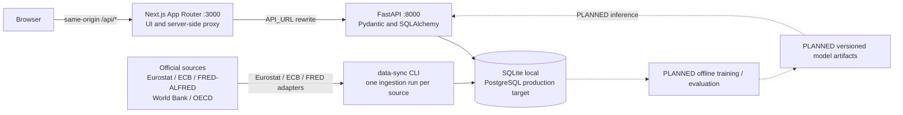
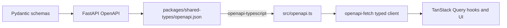
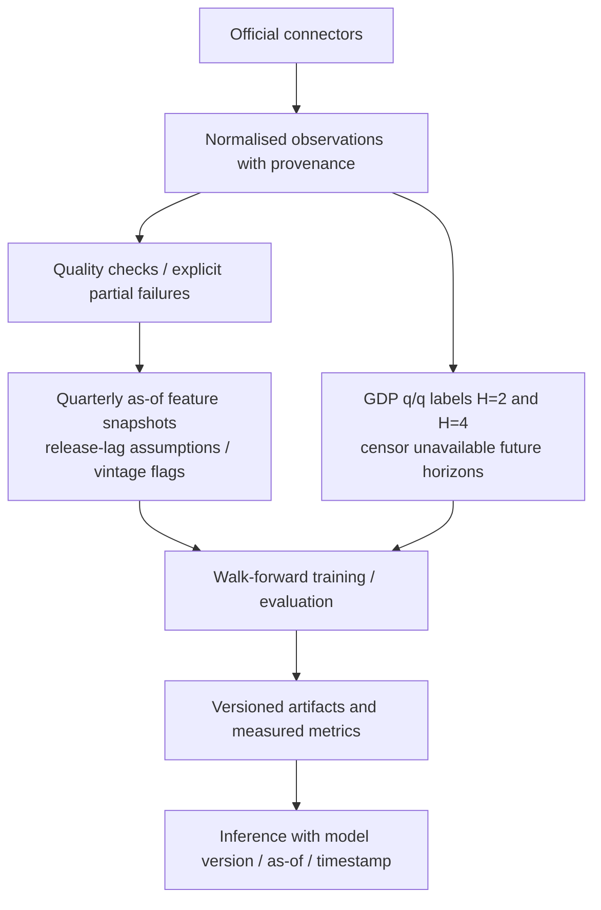

# Architecture

Snapshot: 2026-11-08. [CLAUDE.md](../CLAUDE.md) is authoritative;
[ROADMAP.md](ROADMAP.md) maps planned work to phases. Phase 1 is implemented.
Local verification results below are supplied by the lead engineer in the task brief,
not rerun by this documentation task. Source feasibility is recorded separately in
[DATA_FEASIBILITY.md](DATA_FEASIBILITY.md); a successful probe is not an implemented connector.

## 1. System context and containers



Solid edges describe the current request path; dotted edges are planned. The browser
never calls FastAPI directly. `apps/web/next.config.ts` rewrites `/api/*` to server-side
`API_URL` (default `http://127.0.0.1:8000`). Production targets PostgreSQL through compose;
Docker is absent on the development machine, so images and compose remain locally unverified.
Start with CLI/scheduled jobs; add a worker or Redis only when necessary.

## 2. Repository layout

| Path | Responsibility / state |
|---|---|
| `apps/web/src/app/` | Next.js routes, providers, error boundaries; `globals.css` owns design tokens |
| `apps/web/src/components/shell/` | Sidebar, topbar, country switcher, mobile navigation |
| `apps/web/src/components/ui/`, `components/data/` | Reusable UI states and registry views; planned-module pages |
| `apps/web/src/lib/` | Module registry, typed API client, TanStack Query hooks, formatting |
| `apps/api/src/macropulse_api/` | App factory, settings, middleware, errors, ORM, schemas, CLI |
| `apps/api/src/macropulse_api/routers/`, `services/` | Health/readiness, countries, source status, coverage and registry sync |
| `apps/api/src/macropulse_api/migrations/` | Alembic schema revisions |
| `apps/api/tests/`, `packages/economics/tests/` | Deterministic backend and registry tests |
| `packages/economics/src/macropulse_economics/registry.py` | Country/source metadata now; connectors/transforms/quality planned |
| `packages/shared-types/` | Exported `openapi.json`, generated `src/openapi.ts`, public type exports |
| `packages/ml/` | Planned labeling, features, training, evaluation and inference package; not yet created |
| `scripts/`, `scripts/agents/codex-task.ps1` | Development/probe helpers and delegated Codex task runner |
| `docs/` | Specifications, source feasibility, architecture and roadmap |
| `data/local/macropulse.db` | Local SQLite runtime database |
| `data/demo/`, `data/processed/`, `models/` | Planned attributed DEMO fixtures, ignored generated data and model artifacts |

## 3. Request lifecycle and operational semantics

1. Next.js forwards a same-origin API request to FastAPI.
2. `middleware.py` accepts `X-Request-ID` only when it matches
   `[A-Za-z0-9_-]{8,64}`; otherwise it generates a UUID hex ID. It attaches the ID to
   request state/context and responses passing through the middleware.
3. Pydantic validates input; routers use SQLAlchemy sessions. Countries are case-insensitive.
4. Error handlers serialize safe errors. JSON request logs include UTC timestamp, level,
   logger, message, request ID, method, path, status and duration; query strings are omitted.
5. `openapi-fetch` errors become frontend `ApiError` instances. Network/proxy failures show
   an actionable offline state; TanStack Query avoids retrying deterministic client errors
   and permits one retry for transient failures. Manual retry is available in error states.

Error contract (shape, not a recorded API response):

```text
{"error": {"code": string, "message": string, "details": object | null, "request_id": string | null}}
```

| Case | HTTP / behavior |
|---|---|
| Malformed country code | `422 validation_error`; validation details omit raw input |
| Well-formed country outside registry | `422 unsupported_country`; supported codes in details |
| Known country missing its registry row | `503 registry_not_synced`; migration/seed instruction |
| SQLAlchemy error, including missing tables in an unmigrated DB | `503 database_unavailable`; check `DATABASE_URL`, run `uv run macropulse db upgrade`; driver message is not exposed |
| Unexpected exception | `500 internal_error`; safe public message |
| `GET /api/health` | Liveness only: process/version/environment/time; no DB or source access |
| `GET /api/ready` | `200 ready` only if DB reachable, Alembic revision equals head, and country row count equals registry count; otherwise `503 not_ready` with checks and upgrade hints |

Readiness intentionally returns a `ReadyResponse` diagnostic body rather than the error
envelope; `fetchReady()` handles that `503` as data. Readiness does not validate source
freshness, observation coverage or model availability, and its registry check is a count check.

## 4. Data model

Implemented in `models.py` and the initial Alembic revision:

| Table | Key / stored information | Phase |
|---|---|---|
| `countries` | ISO2 PK, unique ISO3, name/region/currency, euro membership, policy-rate scope, GDP source, target support, timestamps | 1 implemented |
| `data_sources` | Source ID PK, publisher, base/docs/terms URLs, attribution, key requirement/env name, timestamps; no secret values | 1 implemented |
| `ingestion_runs` | Integer PK, source FK, start/finish, running/succeeded/partial/failed, rows upserted, error summary | 1; written by `data-sync` since 3 |
| `observations` | Native series id, source, geo, dataset, series key, period + period start, frequency, value, unit, adjustment, source status flag, source URL, source dataset-update stamp, retrieval time, ingestion run; unique `(series_id, period)` | 3 implemented (migration `0002`) |
| `quality_checks` | Ingestion run, series id, rule, pass/warn/fail, detail | 3 implemented (migration `0002`) |

The following is a **PLANNED entity allocation**, not a claim that migrations exist:

| Entity from CLAUDE.md §5 | Purpose | Planned phase |
|---|---|---|
| `indicator_definitions` | Kept in code (`packages/economics/indicators.py`), versioned with git and served by `/api/indicators/catalog`; a table only if runtime editing is ever needed | — |
| `release_events` | Publication timing per observation; the current endpoints do not provide it, so it is deferred rather than filled with guesses. Phase 8 uses documented publication lags instead and labels every replay an approximation | Deferred: needs a vintage source (ALFRED with a verified `FRED_API_KEY`) |
| `feature_snapshots` | Not a table: snapshots are rebuilt deterministically from stored observations at training time (feature set version + data snapshot hash in `model_versions`) | 5 (implemented in code) |
| `target_labels` | Not a table: labels are derived from stored GDP at training time; status counts and event dates are kept in each artifact's metadata | 5 (implemented in code) |
| `model_versions` | Artifact, training cutoff, target/feature versions, sample counts, snapshot and evaluation method | 5 implemented (migration `0003`) |
| `model_metrics` | Walk-forward/baseline/calibration results and undefined-metric reasons | 5 implemented; display in 6 |
| `prediction_runs`, `predictions` | `model_predictions` stores out-of-sample backtest and current (`live`) estimates per model version (5); on-request inference runs in 6 | 5–6 |
| `scenario_runs` | Not a table: evaluation is stateless and recomputed on request; saved scenarios stay in the browser (localStorage) and export as JSON with request, result and disclaimer | 7 (no server-side persistence) |
| `report_exports` | Not a table: reports are generated on request and not stored; each file carries its generation time, app version, as-of and sources | 9 (no server-side persistence) |

Country support is computed from stored observations: `full` needs verified, fresh real GDP,
inflation and unemployment; `partial` needs real GDP; otherwise `unavailable`. Source health derives only from ingestion-run rows:
no runs means `never_synced`; fetch freshness is the last successful run finish time,
distinct from observation period and publication date.

## 5. Typed contract



Run `pnpm gen:types` at the repository root. This exports the schema using
`uv run macropulse openapi --out packages/shared-types/openapi.json`, then runs the
shared package generator. Do not hand-edit generated types. Current routes cover
health, readiness, countries, source status, the indicator catalog, stored series
(`/api/indicators`), the country KPI summary with an as-of cut-off
(`/api/countries/{iso2}/summary`), per-series lineage and quality
(`/api/countries/{iso2}/data-quality`, `/api/data-quality`) and the raw-observation CSV
(`/api/observations/export`); the model endpoints in the specification remain planned.

## 6. Frontend architecture

| Concern | Current implementation |
|---|---|
| Navigation and phase state | `apps/web/src/lib/modules.ts` is the single source of truth for groups, routes, prerequisites, planned capabilities and `CURRENT_PHASE` |
| Module meaning | `foundation` means a route shows real API state with its full feature set scheduled; `planned` means a not-built page, never simulated output |
| Design | Semantic Tailwind tokens in `apps/web/src/app/globals.css`; reusable primitives in `components/ui/`; Radix accessible controls |
| Server state | `lib/queries.ts` owns stable query keys/hooks; `app/providers.tsx` owns QueryClient/retry policy |
| Honest states | Loading skeletons, error/retry, missing/empty records, explicit not-built modules; no fabricated KPIs or probabilities |
| Shell | Responsive sidebar/mobile drawer, country switcher, system and source status |

Overview, Country Explorer, Compare and Data Observatory are built on stored data (Phase 4):
every chart goes through `components/data/indicator-chart.tsx` (one API series, its provenance,
quality notes and the NBER reference for the US) and every KPI through `/summary`. Model-driven
pages remain honest placeholders. Route existence does not establish a completed analytical feature.

## 7. Data and ML pipeline

Connectors, normalised observations and quality checks are **implemented** (Phase 3,
[ADR-0013](../vault/30%20Decisions/ADR-0013%20Native-series%20ingestion%20with%20quality%20gate.md)).
Labels, as-of feature snapshots, walk-forward training/evaluation and versioned artifacts are
**implemented** in `packages/ml` and `macropulse train` (Phase 5; protocol in
`vault/50 Methodology/Evaluation protocol.md`). Model results are stored in `model_versions`,
`model_metrics` and `model_predictions` and read through `/api/models`. Inference with explanations is
**implemented** (Phase 6): `services/inference.py` rebuilds the as-of snapshot from stored data, loads the
published artifact only from `MODELS_DIR` and returns the probability with version, explanation, track
record and an in-sample flag (`/api/recession/predict`, `/api/recession/history`). Forecasts and scenarios
are **implemented** (Phase 7): `packages/ml/forecast.py` runs a deterministic rolling-origin backtest (naive,
rolling mean, direct ridge AR) and builds empirical 80 % intervals from past errors only;
`services/forecasts.py` cuts the series at the as-of with the publication lags and caches results per stored
series and origin. `services/scenarios.py` maps bounded shocks onto the model inputs, re-scores them with the
published artifact and checks each input and the combination against the training distribution
([ADR-0017](../vault/30%20Decisions/ADR-0017%20Forecasts%20from%20rolling-origin%20backtests.md),
[ADR-0018](../vault/30%20Decisions/ADR-0018%20Scenario%20lab%20as%20bounded%20model%20sensitivity.md)).
Historical replay is **implemented** (Phase 8): `services/replay.py` serves the stored walk-forward estimate
of the published model's fold for that year, rebuilds the inputs known at the cut-off and returns the outcome
window as published later, plus warned / missed / false-alarm episodes. Every replay is a revised-data /
release-lag approximation; no vintages are stored
([ADR-0019](../vault/30%20Decisions/ADR-0019%20Replays%20are%20walk-forward%20fold%20estimates.md)).
Reports are **implemented** (Phase 9): `services/report_builder.py` assembles a `ReportContent`
(`reports/content.py`) from the KPI, series, inference and forecast services; `reports/charts.py`
(matplotlib, Agg), `reports/pdf.py` (reportlab, DejaVu fonts) and `reports/csv_export.py` only lay it out
([ADR-0020](../vault/30%20Decisions/ADR-0020%20Report%20renderers%20only%20lay%20out%20content.md)).



| Stage | Required behavior |
|---|---|
| Connectors | Eurostat JSON-stat/SDMX, ECB SDMX, FRED/ALFRED, World Bank v2, OECD SDMX; verified keys; httpx/certifi TLS; timeouts, backoff/retries, throttling, pagination, caching, resumable sync and response validation |
| Normalisation/quality | Preserve units, frequency, adjustment, source key/URL, retrieval time, known publication dates, revisions and flags. Missing stays null/N/A with a reason; validate adjacent quarters and transformations |
| As-of features | Timestamped availability joins where supported; documented conservative release lags otherwise. Use only already-published annual values with staleness markers. Latest-revision European history must say **revised-data / release-lag approximation** |
| Labels | At least one pair of consecutive negative real GDP q/q quarters entirely inside the next H quarters (H=2/4). Zero is not negative. Missing GDP or an unobservable full horizon prevents a trustworthy label; censor it. NBER/USREC remains a separate external reference |
| Training | Prevalence and interpretable baselines, scaled regularised Logistic Regression, then HistGradientBoosting and/or an installed boosted-tree challenger. Expanding/walk-forward splits with horizon-safe purge/gap and pooled-country temporal isolation; fit preprocessing on training data only |
| Evaluation | Held-out Brier, log loss, ROC/PR-AUC where defined, calibration, thresholded confusion matrix/precision/recall, region/time diagnostics, event/sample counts and baseline comparison; undefined metrics are N/A with a reason |
| Artifacts/inference | Record cutoff, target/feature version, dataset snapshot, seed/command and code revision when known; isolated calibration when sample counts support it. Expose version/date/coverage and limitations, or unavailable state |
| Extensions | Rolling forecast baselines/challenger with tested interval method (7); non-causal sensitivity (7); replay with no future-trained model (8, implemented as revised-data / release-lag approximation; vintage-aware replay deferred). Neural benchmarks only with defensible sample size |

## 8. Security and reliability

| Area | Exists now | Planned / still to verify |
|---|---|---|
| Secrets | Server-side `SecretStr` FRED setting; source API exposes configured boolean only | Bundle/history/deployment secret audit in 10 |
| Request boundary | Pydantic country validation, parameterized ORM queries, explicit CORS origins, wildcard rejected, credentials disabled; bounded forecast metric/horizon/as-of and scenario shocks (`extra="forbid"`) | Bounds for reports/exports as introduced |
| Browser boundary | Same-origin proxy; nosniff, frame denial, referrer and permissions headers | Production deployment verification in 10 |
| Failures/observability | Request IDs, JSON logs, safe error envelope, DB error-class logging, readiness diagnostics and retry UI | Job run metrics, safe connector error summaries, monitoring and broader log audit |
| Data reliability | Metadata registry, migrations and ingestion bookkeeping | Actual sync, quality checks, provenance, freshness and partial-failure handling in 3–4 |
| Expensive operations | No sync/train/report mutation endpoints registered; forecast and scenario computation is read-only, cached where possible and limited in process (`COMPUTE_REQUESTS_PER_MINUTE`, default 240 per client address, 429 with `Retry-After`) | A shared limiter for multi-instance deployments; restricted job execution; no arbitrary shell, URL fetch or unsafe upload |
| Persistence | SQLAlchemy naming convention, SQLite foreign keys, SQLite batch migrations | PostgreSQL/compose runtime validation; backup/deployment procedures |
| Verification | Lead-reported local Phase 1 checks | Docker/compose and full release E2E checks remain unverified |

## 9. Decision log

These are project decisions supplied by the lead engineer or supported by the inspected
code; compatibility observations are recorded as decisions, not independently researched here.

| Decision | Rationale / consequence |
|---|---|
| Phase 1 accepted locally, Windows 11, 2026-11-08 | Lead reports 27 pytest tests; ruff lint/format and strict mypy clean; web tsc/ESLint clean, 16 Vitest tests, Next build OK (12 routes); browser navigation, country switcher, mobile drawer and API-offline/retry checked |
| Python 3.12 via uv | `.python-version` is 3.12; workspace members are `apps/api` and `packages/economics`. Installed Python 3.15 is too new for the scientific stack; ML package is future work |
| TypeScript 6.0.3 | Native TS 7 is not yet compatible with the chosen Next.js type-checking and openapi-typescript workflow |
| ESLint 9.39.5 | eslint-config-next's react, jsx-a11y and import plugins do not yet support ESLint 10 |
| Next.js server-side API proxy | Browser stays on one origin; backend URL stays server-side. FastAPI CORS still allows explicit origins only |
| SQLite locally; PostgreSQL production target | Frictionless Windows development at `data/local/macropulse.db`; naming convention and SQLite batch mode preserve migration portability, pending PostgreSQL runtime checks |
| Docker work remains unverified locally | Docker is not installed; compose/images are written by the lead, with CI intended to build them |
| httpx with certifi for connectors | Windows system trust lacks on-demand Eurostat/ECB roots; use certifi CA bundle, preserving TLS validation |
| Metadata and coverage are separate | Registry targets are not achieved coverage; no observations means unavailable, no sync means never_synced |
| CLI jobs before extra infrastructure | Avoid worker/Redis infrastructure until operational need is demonstrated |
| Scoped Codex delegation | `scripts/agents/codex-task.ps1` delegates side tasks; sandbox has no network or per-user Python, so lead runs live probes and owns final verification |

Official source references and exact probe limitations: [DATA_FEASIBILITY.md](DATA_FEASIBILITY.md).
