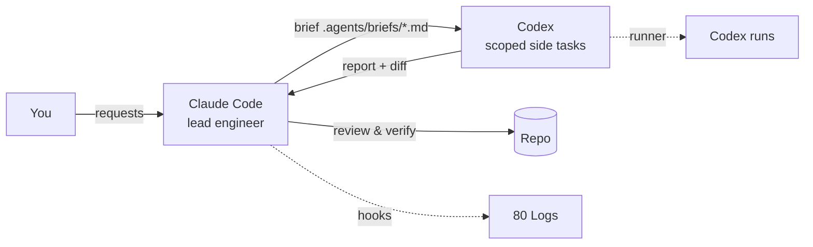

# 🤖 Agent workflow



## Roles
- **Claude Code** — architecture, task list, implementation, verification, curated vault notes.
- **Codex** — delegated side tasks (docs, reviews, isolated code) via `scripts/agents/codex-task.ps1`; rules in `AGENTS.md`. Each brief lists the only files Codex may touch.
- Every Codex result is reviewed and re-verified by Claude before it is accepted. → [[ADR-0009 Claude leads, Codex takes scoped side tasks]]

## Delegating a task
```powershell
./scripts/agents/codex-task.ps1 -Name <slug> -PromptFile .agents/briefs/<slug>.md [-Sandbox read-only] [-Effort medium]
```
Each run is saved in `.agents/codex-runs/` and recorded here automatically as a note in `60 Agents/Codex runs/` (see the base on [[Home]]).

> [!warning] Sandbox limits
> Codex's Windows sandbox has **no network** and **no per-user Python** — [[F-005 Codex sandbox has no network]].

## Automatic logging
| Source | Where | What |
| --- | --- | --- |
| Claude Code hooks (`.claude/settings.json`) | `80 Logs/YYYY-MM-DD.md` | prompts, file edits, commands (with descriptions), subagents, skills, final replies, session start/end |
| Codex runner | `60 Agents/Codex runs/` + daily log | brief, report, sandbox, exit code |
| SessionStart hook | Claude's context | the `## Now` section of [[Status]] |

Secrets are redacted before writing (`scripts/obsidian/vault_log.py`).

## Installed tooling (2026-11-08/09)
- **Codex plugins (14):** data-analytics, build-web-data-visualization, product-design, codex-security, impeccable, frontend-design-premium, codex-engineering-guardrails, codex-dev-workflows, codex-coordinator, ai-software-architect, fastapicloud, public-equity-investing, github, vercel.
- **Codex skills:** define-goal, gh-address-comments, gh-fix-ci, jupyter-notebook, pdf, playwright, playwright-interactive, screenshot, security-best-practices, security-threat-model, security-ownership-map, render-deploy, vercel-deploy, yeet + Obsidian skills (obsidian-markdown, obsidian-bases, json-canvas, obsidian-cli).
- **Codex MCP:** Context7 (docs).
- **Claude:** Obsidian skills (same four) in `~/.claude/skills`; plugin `codex@openai-codex` enabled; 15 suggested directory plugins awaiting install.
